# KCC Board 사용 매뉴얼 (v0.7.1)

KCC Board는 석고보드·스터드 부분합성 건식벽체의 면외 구조검토 프로그램이다. 벽체 구성과 하중을 입력하면 응력·처짐·피스 인장을 검토하고, 최대 가능 높이와 앵커 기준 최대높이를 산정한다. 결과는 계산서로 출력할 수 있다.

> 본 결과는 전체 석고보드 구성에 대한 실험 검증값이 아니다. 석고보드·스터드 및 합성 효과에 대한 실험 물성치를 바탕으로 이론 계산식에 따라 산정한 값이다.

화면 캡처는 v0.7.1 기본값 기준이다(2026-10-25).

프로그램 안에서 이 매뉴얼을 열려면 메뉴 **Help → 사용 매뉴얼**을 고르거나 **F1**을 누른다. 매뉴얼은 별도 창으로 열리며, 계산 화면의 입력값은 그대로 유지된다.

## 1. 설치와 실행

1. GitHub Release에서 `KCC.Board.Setup.0.7.1.exe`를 내려받는다.
2. 설치 파일을 실행한다. 현재 사용자 계정에 설치된다.
3. Windows SmartScreen 경고가 나오면 "추가 정보 → 실행"을 누른다. 코드서명 인증서가 없어서 나오는 경고이다.
4. 시작 메뉴에서 KCC Board를 실행한다.
5. 화면 오른쪽 위에 "API 연결됨"이 표시되는지 확인한다. "대기"가 계속되면 프로그램을 다시 실행한다.

## 2. 화면 구성

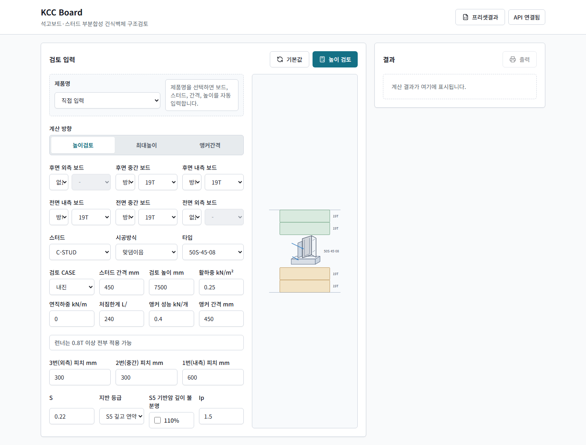

| 영역 | 내용 |
|---|---|
| 상단 | 프로그램명, "프리셋결과" 버튼, API 연결 상태 |
| 검토 입력(왼쪽) | 제품 선택, 계산 방향, 보드·스터드·하중·피스·지진 입력. "기본값"·계산 버튼 |
| 단면 미리보기(가운데) | 입력한 보드·스터드 구성을 그림으로 표시. 위가 전면, 아래가 후면 |
| 결과(오른쪽) | 판정, 주요 수치, 안내 문구, "출력" 버튼 |
| 계산서 미리보기(아래) | 계산 후 표시 |

## 3. 기본 사용 절차

1. "계산 방향"을 고른다(4절).
2. 제품을 고르거나 "직접 입력"으로 둔다(5.1절).
3. 보드, 스터드, 하중, 피스, 지진 값을 입력한다(5.2~5.6절).
4. 단면 미리보기에서 구성을 확인한다.
5. 계산 버튼("높이 검토", "최대높이 산정", "앵커간격 산정")을 누른다.
6. 결과 패널에서 판정과 안내 문구를 확인한다(6절).
7. 필요하면 "계산서 출력"을 누른다(7절).

입력을 처음 상태로 되돌리려면 "기본값"을 누른다.

## 4. 계산 방향

| 계산 방향 | 높이 입력란 | 버튼 | 결과 |
|---|---|---|---|
| 높이검토 | 검토 높이 mm | 높이 검토 | 입력 높이에서 응력·처짐·피스 인장 판정(O.K / N.G) |
| 최대높이 | 산정 높이 mm | 최대높이 산정 | 응력·처짐·피스 인장을 모두 만족하는 최대 가능 높이(50 mm 단위) |
| 앵커간격 | 앵커 산정 기준높이 mm | 앵커간격 산정 | 위 검토와 앵커 사용률 ≤ 1.0을 함께 만족하는 앵커 기준 최대높이(50 mm 단위) |

- 최대높이·앵커간격은 50 mm부터 30,000 mm까지 50 mm 간격으로 계산한다. 입력 높이가 30,000 mm보다 크면 그 높이까지 계산한다.
- 최대높이·앵커간격을 산정하면 산정 높이를 높이 입력란에 자동으로 넣는다. 결과 패널의 상세 수치는 그 높이에서 다시 계산한 값이다.
- 앵커간격은 내진 CASE에서만 값을 낸다. 비내진이면 앵커 기준 최대높이는 0이다.
- 계산 방향이나 제품을 바꾸면 이전 결과를 지운다.

## 5. 입력 항목

### 5.1 제품명

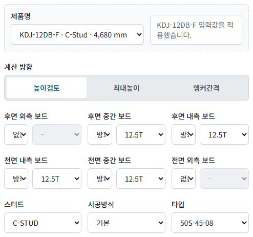

- 목록에서 제품을 고르면 보드, 스터드, 간격, 높이, 앵커 간격을 자동 입력한다. 계산 방향은 "높이검토"로 바뀐다.
- 오른쪽 상자에 적용 결과를 표시한다. 제품 정보가 DB와 맞지 않으면 대체한 값을 안내한다. 안내를 확인한 뒤 계산한다.
- 목록 표시는 "도면명 · 스터드 · 내진 반영 높이"이다. "(신규)"는 신규 제품이다.

### 5.2 석고보드

후면 3장, 전면 3장까지 입력한다. 각 칸에서 왼쪽 목록으로 종류를, 오른쪽 목록으로 두께를 고른다. 사용하지 않는 칸은 "없음"으로 둔다.

| 칸 | 피스 번호 | 위치 |
|---|---|---|
| 내측 | 1번 | 스터드에 붙는 보드 |
| 중간 | 2번 | 가운데 보드 |
| 외측 | 3번 | 스터드에서 가장 먼 보드 |

- 물성(단위중량·강도·탄성계수)이 모두 등록된 보드만 고를 수 있다.
- 다음 경우에는 후면 보드 입력이 자동으로 바뀐다.

| 조건 | 후면 보드 |
|---|---|
| C-STUD 시공방식 "일면마감" 또는 "이중스터드" | 입력할 수 없음(모든 칸 "없음", 비활성화). 한쪽 면만 검토하는 공법임 |
| CH-STUD | 후면 내측 1장, 두께 25T 고정 |
| CH-STUD(개량형) | 후면 내측 1장, 두께 12.5T 고정 |
| I-STUD | 후면 내측 1장, 방화 25T 고정 |

C-STUD 이중스터드를 고른 화면이다. 후면 보드 3칸이 모두 "없음"으로 비활성화된다.

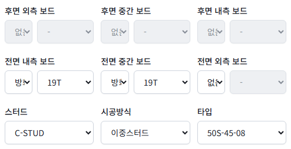

CH-STUD를 고른 화면이다. 후면 내측 보드 두께가 25T로 고정되고 외측·중간은 비활성화된다.

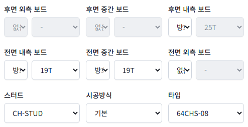

### 5.3 스터드

| 항목 | 내용 |
|---|---|
| 스터드 | 형식(C·CH·CH(개량형)·T.silent·R·I·HR·RV·MP-STUD) |
| 시공방식 | C-STUD: 기본, 맞댐이음, 중앙부 이음, 이중스터드, 일면마감. 다른 형식: 기본 |
| 타입 | 형식별 규격(예: 50S-45-08) |

- 스터드 형식을 바꾸면 시공방식과 타입은 그 형식의 첫 항목으로 바뀐다.
- 계산할 수 있는 형식은 시험 보정계수가 산정된 시험 형식뿐이다. 다른 형식은 "적용 범위 밖" 오류로 계산하지 않는다.
- C-STUD에 후면 보드가 없으면 시공방식과 관계없이 "C-STUD 기본 일면" 시험 형식의 계수를 적용한다.

### 5.4 하중·검토 조건, 5.5 피스 피치, 5.6 지진

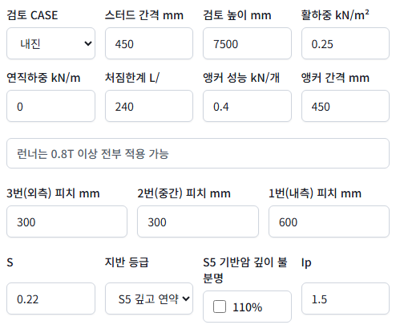

하중·검토 조건

| 항목 | 단위 | 기본값 | 설명 |
|---|---|---|---|
| 검토 CASE | — | 내진 | 내진 / 비내진. 비내진은 지진하중을 검토하지 않음 |
| 스터드 간격 | mm | 450 | 스터드 중심 간격 |
| 검토 높이(계산 방향별 명칭) | mm | 7,500 | 벽체 높이(스팬) |
| 활하중 | kN/m² | 0.25 | 면외 수평하중 |
| 연직하중 | kN/m | 0 | 벽체 상부 연직하중 |
| 처짐한계 L/ | — | 240 | 허용처짐 = 높이 / 입력값 |
| 앵커 성능 | kN/개 | 0.4 | 앵커 1개 허용 성능 |
| 앵커 간격 | mm | 450 | 150~600, 50 mm 단위 |

런너는 0.8T 이상이면 모두 적용할 수 있다.

피스 피치

| 항목 | 표준값 | 적용 보드 |
|---|---|---|
| 3번(외측) 피치 | 300 mm | 외측 보드 |
| 2번(중간) 피치 | 300 mm | 중간 보드 |
| 1번(내측) 피치 | 600 mm | 내측 보드 |

- 해당 번호의 보드가 없으면 그 피치는 계산에 쓰지 않는다.
- 표준값과 다르게 입력하면 결과에 노란색 안내가 나온다(6.3절). 판정은 계산하지만 결과 적용에 유의한다.

지진

| 항목 | 기본값 | 설명 |
|---|---|---|
| S | 0.22 | 유효지반가속도 |
| 지반 등급 | S5 | S1~S5. Fa는 지반 등급과 S로 자동 산정 |
| S5 기반암 깊이 불분명 | 해제 | S5에서만 선택 가능. 선택하면 Fa에 110%를 적용 |
| Ip | 1.5 | 중요도계수 |

## 6. 결과 보기

### 6.1 높이검토 결과

기본값에서 검토 높이를 6,000 mm로 두고 "높이 검토"를 누른 결과이다.

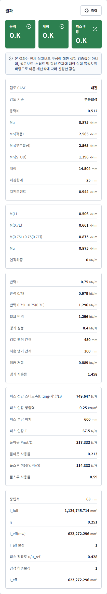

| 영역 | 내용 |
|---|---|
| 판정 카드 | 응력, 처짐, 피스 인장. 초록색 O.K, 빨간색 N.G |
| 안내 문구 | 실험 검증 범위 안내(항상), 입력 경고(해당 시) |
| 휨·처짐 | 검토 CASE, 강도 기준(부분합성), 응력비, Mu, Mn(적용·부분합성·STUD), 처짐, 처짐한계, 지진모멘트(내진) |
| 하중조합 | M(L), M(0.7E), M(0.75L+0.75(0.7E)), Mu, 연직하중 |
| 반력·앵커 | 반력 L·0.7E·조합, 필요 반력, 앵커 성능, 검토 앵커 간격, 허용 앵커 간격, 앵커 저항, 앵커 사용률 |
| 피스 | 피스 전단 스터드측, 피스 인장 횡압력·부담 피치·인장 T, 풀아웃·풀스루 허용값과 사용률 |
| 단면 | 중립축, I_full, η(합성률), I_eff(raw), I_eff 보정(R), 피스 활용도 u/u_ref, 강성 하중보정, I_eff |

판정 기준

| 판정 | 기준 |
|---|---|
| 응력 | 응력비 = Ω·Mu / Mn ≤ 1.0 (Mu 설계 모멘트, Mn 공칭 휨강도) |
| 처짐 | 활하중 처짐 ≤ 처짐한계 |
| 피스 인장 | 풀아웃·풀스루 사용률 ≤ 1.0 |

- 높이검토의 판정에는 앵커 사용률이 들어가지 않는다. 앵커는 "앵커 사용률"과 "허용 앵커 간격"으로 확인한다.
- 강성 하중보정은 피스 활용도 u/u_ref가 1.0 이하이면 1이다. 1.0을 넘으면 강성을 낮춘다.

### 6.2 최대높이·앵커간격 결과

최대높이 산정 결과이다. 맨 위에 최대 가능 높이를 크게 표시한다.

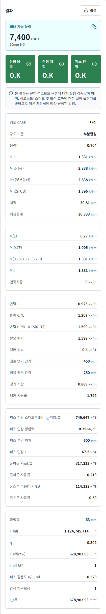

앵커간격 산정 결과이다. 맨 위에 앵커 기준 최대높이를 표시한다.

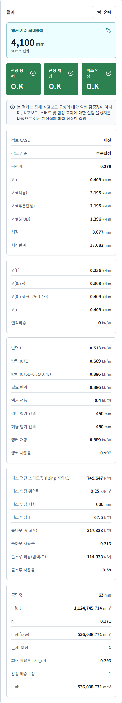

### 6.3 안내 문구

2번(중간) 피치를 표준 300 mm 대신 400 mm로 입력한 결과이다. 판정 카드 아래에 노란색 안내가 나온다.

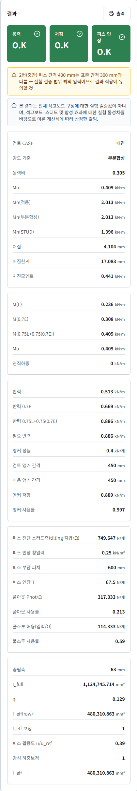

| 색 | 내용 | 판정 영향 |
|---|---|---|
| 노란색 | 표준 외 피스 간격, 중립축이 스터드 밖에 있음 등 입력 경고 | 없음. 결과 적용에 유의 |
| 회색 | 실험 검증 범위 안내(항상 표시) | 없음 |

## 7. 계산서 출력

1. 계산을 실행한다.
2. 아래쪽 "계산서 미리보기"에서 내용을 확인한다.
3. "계산서 출력"(또는 결과 패널의 "출력")을 누른다.
4. 인쇄 대화상자에서 프린터를 고르거나 "PDF로 저장"을 고른다.

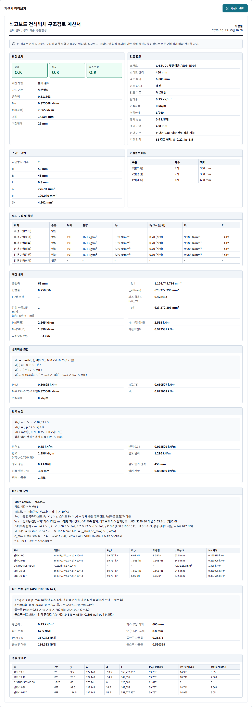

| 계산서 항목 | 내용 |
|---|---|
| 판정 요약, 검토 조건 | 판정, 계산 방향, 주요 결과, 입력 조건 |
| 스터드 단면, 연결볼트 배치 | 단면 성능, 층별 피스 개수·피치 |
| 보드 구성 및 물성 | 층별 종류·두께·질량·Fy·항복비·Fu·E |
| 계산 결과 | 중립축, η, I_eff, Mn, 지진모멘트 |
| 설계하중 조합, 반력 산정 | 계산식과 값 |
| Mn 산정 상세 | 층별 기여 |
| 피스 인장 검토 | AISI S100-16 J4.4 풀아웃·풀스루 |
| 층별 중간값 | 층별 위치·단면·항복축력·전단 누계 |

## 8. 프리셋결과

상단 "프리셋결과" 버튼은 기존 제품별 검토 결과 목록(xlsx 기준)을 연다. "계산 화면" 버튼으로 돌아온다.

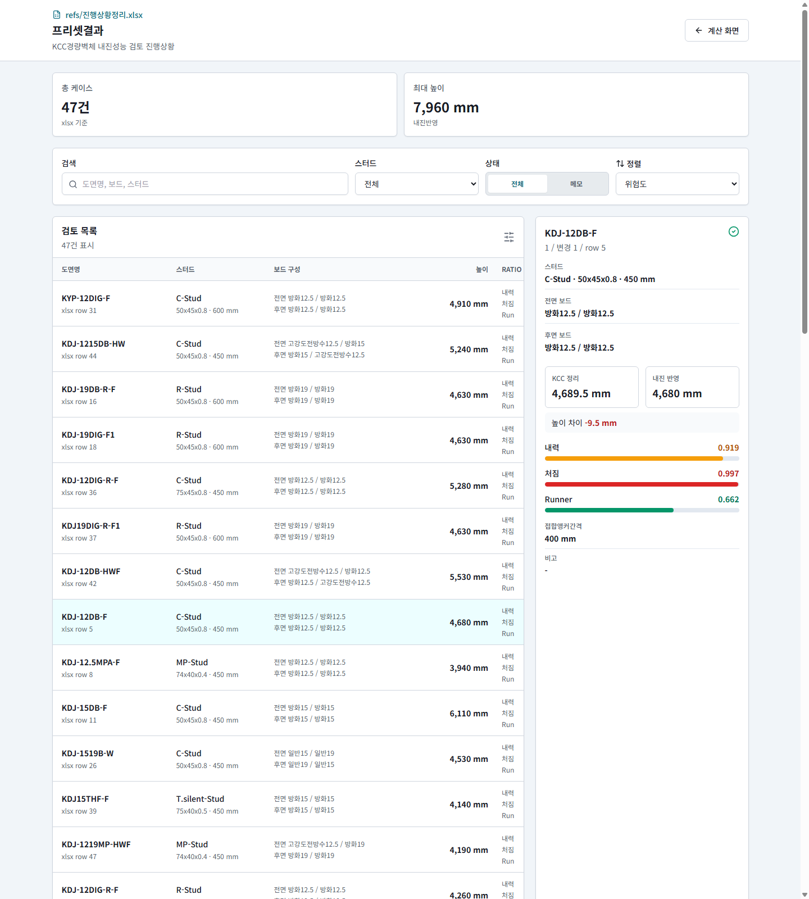

1. "검색"에 도면명·보드·스터드를 입력해 목록을 거른다.
2. "스터드"·"상태"로 목록을 거른다.
3. "정렬"에서 위험도·높이·도면명 순서를 고른다.
4. 목록에서 행을 누르면 오른쪽에 상세(보드 구성, KCC 정리·내진 반영 높이, 내력·처짐·Runner 비율)를 표시한다.

## 9. 오류 메시지

오류는 "검토 입력" 상단에 빨간색 상자로 표시된다.

| 메시지(요지) | 원인 | 조치 |
|---|---|---|
| 시험 보정계수 R이 산정되지 않은 형식으로 적용 범위 밖 | 시험 형식이 아닌 스터드 | 시험 형식(C·CH·T.silent·R·I·HR·RV·MP-STUD)으로 바꾼다 |
| 이중스터드·일면마감은 후면 석고보드를 입력할 수 없음 | 일면 검토 공법에 후면 보드 입력 | 후면 보드를 "없음"으로 둔다(화면에서는 자동 처리) |
| 후면 석고보드 1장만 허용 / 고정 | CH·I-STUD 후면 보드 조건 위반 | 5.2절 고정 조건대로 입력한다 |
| 중립축이 적용 범위 밖 | 한쪽 보드 구성이 지나치게 두꺼움 | 보드 구성을 조정한다 |
| 자재 DB 조회 실패 | DB에 없는 보드·규격 | 목록에 있는 값으로 고른다 |
| 50mm 단위로 입력해야 합니다 | 앵커 간격 단위 오류 | 150~600 mm, 50 mm 단위로 입력한다 |
| 자재 목록을 불러오지 못했습니다 | 백엔드 미연결 | 프로그램을 다시 실행한다 |

## 10. 적용 범위와 주의

- 계산식과 계수의 근거는 `docs/var_formula_spec.md`, 변경 이력은 `docs/review_round1_changes.md`에 있다.
- 형식별 보정계수 R은 시험 시편 11종의 허용처짐 상태에서 산정한 값이다. 시편과 다른 높이·간격 구성에도 같은 값을 적용한다.
- 이중스터드는 고유 시험이 없어 일면 시험(C-STUD 기본 일면) 계수를 적용한다(확인 필요).
- 표준 외 피스 간격 등 실험 검증 범위 밖의 입력은 결과 적용에 유의한다.
