# 경량철골 스터드와 석고보드의 부분합성을 고려한 칸막이벽체 허용높이 산정 프로그램 (KCC Board) 사용 매뉴얼 (v0.7.4)

경량철골 스터드와 석고보드의 부분합성을 고려한 칸막이벽체 허용높이 산정 프로그램(이하 KCC Board)은 석고보드·스터드 부분합성 건식벽체의 면외 구조검토 프로그램이다. 벽체 구성과 하중을 입력하면 응력·처짐·피스 인장을 검토하고, 내진에서는 런너 고정못 사용률을 함께 검토한다. 결과는 요약페이지 또는 상세 계산서로 출력할 수 있다.

> [주의] 본 결과는 이론 계산값임. 실험으로 검증된 범위는 KCC 11종 시험 시편의 구성(스터드 형식·규격, 보드 종류·두께·겹수, 스터드 간격 300·450·600 mm)과 시험 높이 2.4 m에 한정되며, 산정된 허용높이는 시험 높이를 초과하는 외삽값임. 시험 범위 외 구성(보드 종류·두께·겹수·간격·시공방식의 변경)은 실험으로 직접 검증되지 않았으므로 결과 적용 시 설계자(구조기술자)의 공학적 판단과 확인이 필요함. 합성률 η 및 보정계수 R의 수치 적정성은 기술인증 범위에 포함되지 않음.

메뉴 Help → 사용 매뉴얼 또는 F1으로 이 매뉴얼을 연다. 별도 창으로 열리며 계산 화면의 입력값은 유지된다. 메뉴 Help → 프로그램 정보에서 프로그램 제목과 버전을 확인한다. 화면은 v0.7.3 기준이다.

## 1. 설치와 실행

1. GitHub Release에서 `KCC.Board.Setup.0.7.4.exe`를 내려받는다.
2. 설치 파일을 실행한다. 현재 사용자 계정에 설치된다.
3. Windows SmartScreen 경고가 나오면 "추가 정보 → 실행"을 누른다. 코드서명 인증서가 없어서 나오는 경고이다.
4. 시작 메뉴에서 KCC Board를 실행한다.
5. 화면 상단의 API 연결 상태를 확인한다. 자재 목록을 불러오지 못하면 프로그램을 다시 실행한다.

## 2. 화면 구성

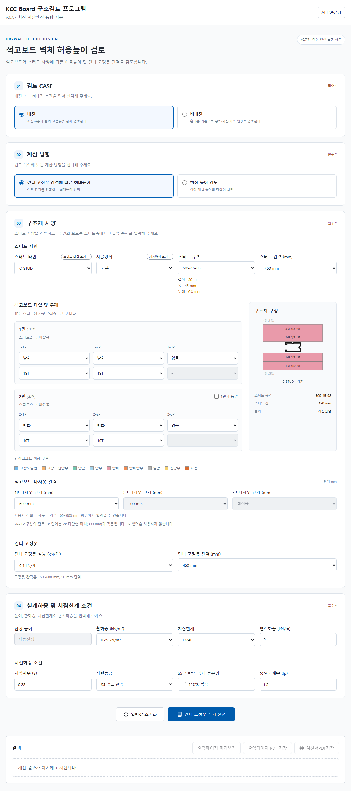

| 영역 | 내용 |
|---|---|
| 검토 CASE | 내진 또는 비내진 선택 |
| 계산 방향 | 최대높이 산정 또는 현장 높이 검토 |
| 구조체 사양 | 스터드·시공방식·규격, 양면 보드, 나사못 및 런너 고정못 입력 |
| 구조체 구성 | 입력한 보드와 스터드의 구성 그림 |
| 설계하중 및 처짐한계 조건 | 현장 높이, 활하중, 처짐한계, 연직하중 및 지진 조건 |
| 계산 결과 | 판정, 주요 수치와 입력 조건 |
| 요약·상세 미리보기 | 요약페이지 및 구조계산서 확인·PDF 저장 |

## 3. 기본 사용 절차

1. 내진 또는 비내진 CASE를 선택한다.
2. 최대높이 산정 또는 현장 높이 검토를 선택한다.
3. 스터드·시공방식·규격과 각 면의 보드를 선택한다.
4. 나사못 간격과 내진의 런너 고정못 조건을 입력한다.
5. 설계하중과 처짐한계, 내진의 지진 조건을 입력한다.
6. 구조체 구성 그림을 확인하고 하단 계산 버튼을 누른다.
7. 판정과 요약·상세 미리보기를 확인한 뒤 필요한 PDF를 저장한다.

입력을 초기 상태로 되돌리려면 입력값 초기화를 누른다.

## 4. 계산 방향

| 계산 방향 | 높이 입력 | 결과 |
|---|---|---|
| 비내진 최대높이 산정 | 자동산정, 직접 입력 불가 | 응력·처짐·피스 인장을 만족하는 최대높이 |
| 내진 런너 고정못 간격에 따른 최대높이 | 자동산정, 직접 입력 불가 | 응력·처짐·런너 고정못·피스 인장을 만족하는 최대높이 |
| 현장 높이 검토 | 계획한 현장 높이를 입력 | 입력 높이에서 각 항목의 적합성 판정 |

최대높이는 50 mm 단위로 산정한다. 산정 후 표시되는 상세 수치와 판정은 산정된 높이 기준이다. CASE나 계산 방향을 바꾸면 이전 결과를 지우고 다시 계산한다.

## 5. 입력 항목

### 5.1 석고보드

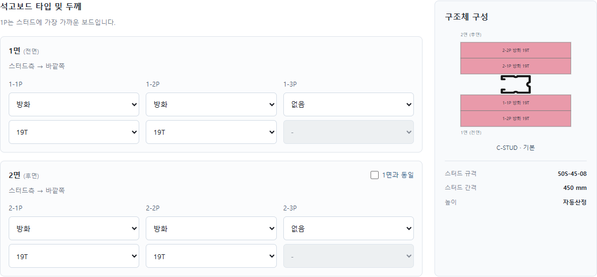

1면은 전면, 2면은 후면이다. 각 면 최대 3장까지 종류와 두께를 선택한다. 1P는 스터드에 가장 가까운 보드이며 2P·3P 순서로 바깥쪽에 놓인다. 사용하지 않는 칸은 없음으로 둔다.

2면의 1면과 동일을 선택하면 1면의 종류와 두께를 2면에 동일하게 적용한다. 고정 구성에서는 이 기능을 사용할 수 없다. 보드 색상 구분은 입력 화면 아래 범례에서 확인한다.

| 조건 | 2면 후면 보드 |
|---|---|
| C-STUD 일면마감 또는 이중스터드 | 한쪽 면만 검토하므로 모든 칸 없음, 입력 비활성화 |
| CH-STUD | 후면 1장, 두께 25T 고정 |
| CH-STUD 12.5T형 | 후면 1장, 두께 12.5T 고정 |
| I-STUD | 후면 1장, 등록된 보드 종류·두께 선택 가능 |

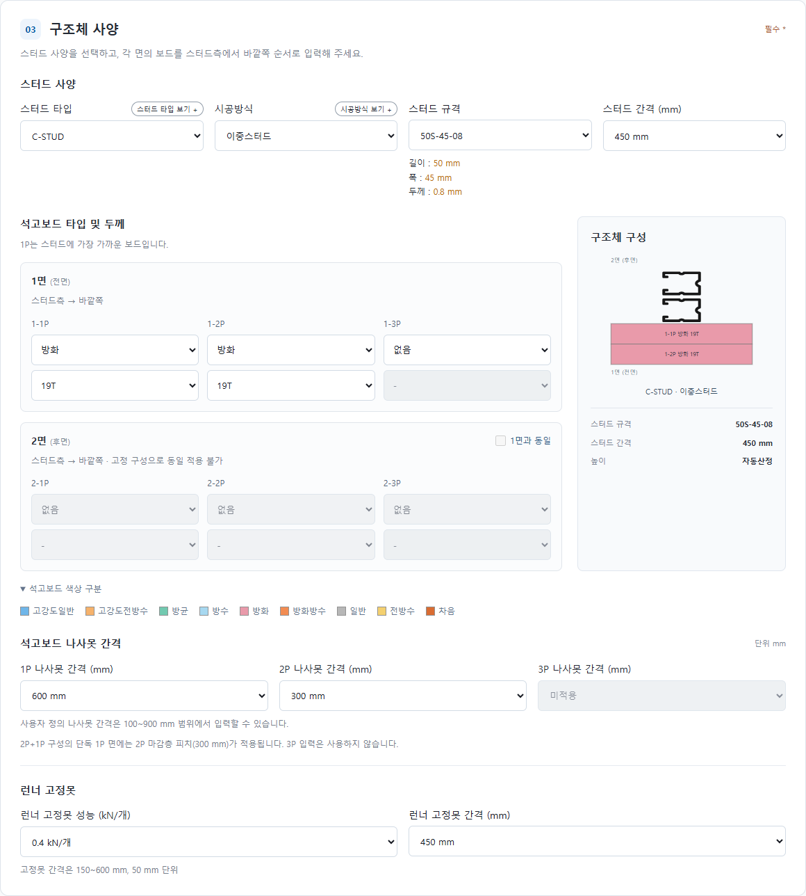

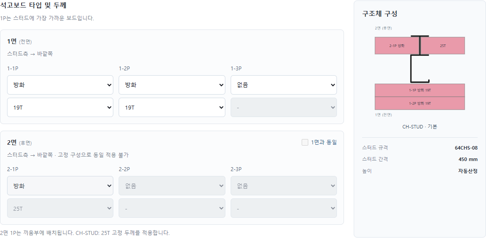

### 5.2 스터드

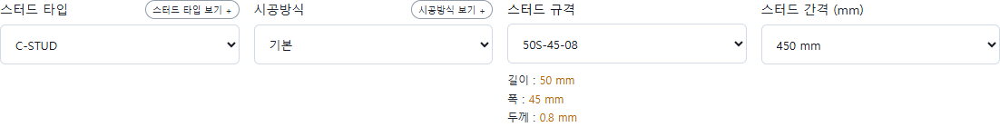

| 항목 | 내용 |
|---|---|
| 스터드 타입 | C·CH·CH 12.5T형·I·HR·MP·T.silent·R·RV |
| 시공방식 | 선택한 스터드에 적용 가능한 방식 |
| 스터드 규격 | 형식별 등록 규격과 길이·폭·두께 정보 |
| 스터드 간격 | 300·450·600 mm 또는 사용자 정의 150~600 mm. 시험 검증 간격은 300·450·600 mm |

스터드 타입 보기와 시공방식 보기를 누르면 해당 설명 이미지를 팝업으로 볼 수 있다. 스터드 타입을 변경한 뒤 시공방식과 규격을 확인한다. 시험 보정계수가 없는 형식은 적용 범위 밖으로 계산하지 않는다.

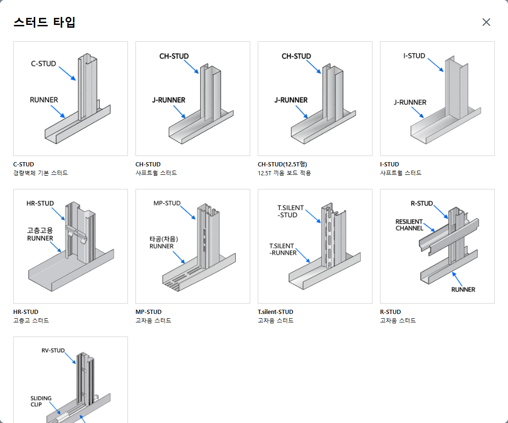

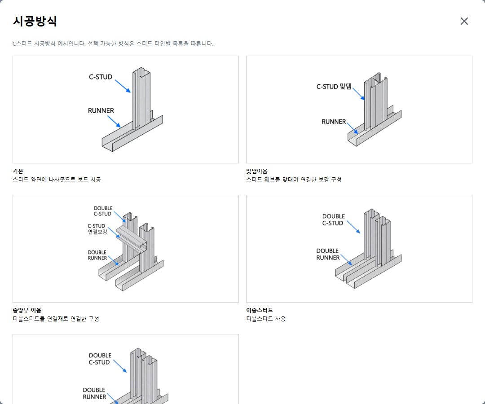

### 5.3 나사못과 런너 고정못

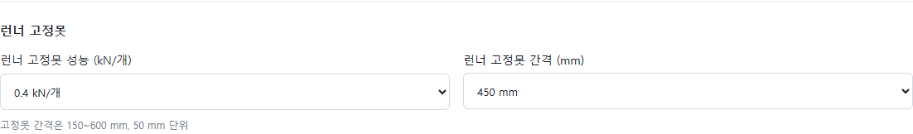

| 항목 | 선택 범위 |
|---|---|
| 각 겹 나사못 간격 | 300·450·600 mm 또는 사용자 정의 100~900 mm |
| 런너 고정못 허용내력 (제조사 설계값) | 0.4·0.2 kN/개(예시값) 또는 사용자 정의 |
| 런너 고정못 간격 | 150~600 mm, 50 mm 단위 |
| 허용내력 출처(제조사·제품명) | 선택 입력, 200자 이하. 계산서 표기 전용 |

실제 사용하는 겹수의 나사못 간격을 확인한다. 런너 고정못 항목은 내진 CASE에서만 표시된다.

런너 고정못 허용내력은 다음 순서로 입력한다.

1. 제조사 시험성적서에서 허용내력(kN/개)을 확인한다. 매입깊이·모재(콘크리트) 강도·직경 조건이 실제 시공 조건과 같은지 확인한다.
2. 허용내력을 사용자 정의로 입력한다. 프리셋 0.4·0.2 kN은 예시값이다.
3. 허용내력 출처에 제조사·제품명(필요하면 시험성적서 번호)을 입력한다.

계산서 입력조건 표에 "고정못 허용내력 출처"가 표시된다. 출처를 입력하지 않으면 "—"로 표시된다. 고정못 허용내력은 입력값 기준이며, 제품 성능의 검증은 본 프로그램 범위 외이다.

### 5.4 하중과 처짐한계

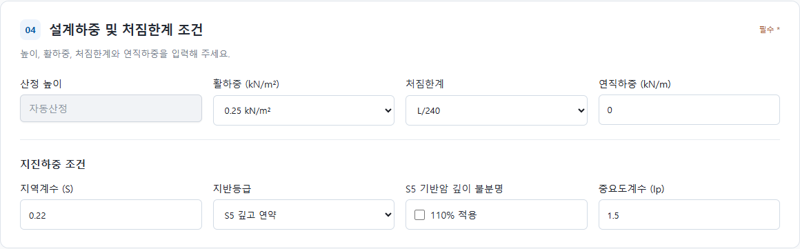

| 항목 | 입력 방법 | 의미·출처 |
|---|---|---|
| 현장 높이 | 현장 높이 검토에서 mm 단위 입력 | 상·하부 런너 지지점 간 순높이(바닥~슬래브 하부). 부분높이·개구부 벽체는 적용 범위 외 |
| 활하중 | 0.25·0.36·0.48 kN/m² 또는 사용자 정의 | 0.25 kN/m²: KDS 41 12 00 (3.7.2) 내벽 횡하중 최소값(높이 1.8 m 이상 내벽). 0.36·0.48 kN/m²: 상향 적용 시 선택값 |
| 처짐한계 | L/240·L/300·L/360 또는 사용자 정의 | L/240: 석고보드 마감 일반 한계(기본값). L/300·L/360: 타일·석재 등 취성 마감 또는 발주처 요구 시 |
| 연직하중 | kN/m 단위 입력, 기본값 0 | 벽체 상부에 작용하는 연직하중(kN/m). 비내력 칸막이벽은 통상 0 |

입력 화면의 각 항목 아래에 같은 설명이 표시된다. 항목 이름 위에 마우스를 올리면 툴팁으로도 볼 수 있다.

처짐한계는 높이를 선택한 분모로 나눈 값이다. 예를 들어 높이 3,840 mm, L/240이면 허용처짐은 16 mm이다.

### 5.5 지진

| 항목 | 기본값 | 설명 | 의미·출처 |
|---|---|---|---|
| 지역계수 S | 0.22 | 유효지반가속도 입력 | 지진구역 I: 0.22, 지진구역 II: 0.14 (KDS 41 17 00) |
| 지반등급 | S5 | S1~S5, Fa 자동 산정 | 단주기 지반증폭계수 Fa 자동 산정(KDS 41 17 00 표 4.2-1) |
| S5 기반암 깊이 불분명 | 해제 | S5에서 선택 시 Fa 110% 적용 | S5 지반에서 기반암 깊이 불분명 시 Fa 1.1배 |
| 중요도계수 Ip | 1.5 | 중요도계수 입력 | 1.0: 일반 비구조요소 / 1.5: 피난경로·위험물·중요도(특) 건축물 |
| 설치높이비 z/h | 1.0 | 0.0~1.0 입력, 빈 값은 오류 | z: 벽체 설치 층 높이, h: 건물 평균 지붕 높이. 모르면 1.0(최상층, 안전측) |

z/h가 작을수록 Fp 계수가 작아진다. z/h = 1.0이면 0.48, z/h = 0.5이면 0.32이다. z/h가 0.4375 미만이면 하한 0.3을 적용한다. 계산서의 Fp 산정 행에 ap, Rp, z/h, 계수, 상·하한 적용 여부가 표시된다.

지진하중 조건 소제목 아래에 산정식 요약이 표시된다.

> Fp = 0.4·ap·SDS·Ip·Wp·(1+2z/h)/Rp (ap = 1.0, Rp = 2.5), 0.3·SDS·Ip·Wp ≤ Fp ≤ 1.6·SDS·Ip·Wp

비내진 CASE에서는 지진 관련 입력과 결과가 표시되지 않는다.

## 6. 결과 보기

### 6.1 현장 높이 검토

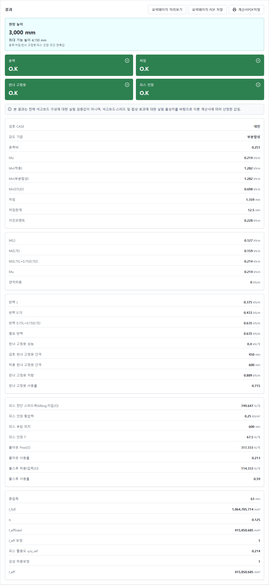

| 판정 | 기준 |
|---|---|
| 응력 | Ω·Mu/Mn ≤ 1.0 |
| 처짐 | 활하중 처짐 ≤ 높이/처짐한계 분모 |
| 런너 고정못 | 사용률 ≤ 1.0, 내진에서만 검토 |
| 피스 인장 | 풀아웃·풀스루 사용률 ≤ 1.0 |

내진은 4개, 비내진은 3개 판정을 표시한다. 초록색 O.K는 만족, 빨간색 N.G는 불만족이다. 결과와 계산서의 검토 높이가 의도한 높이와 같은지 확인한다.

### 6.2 최대높이

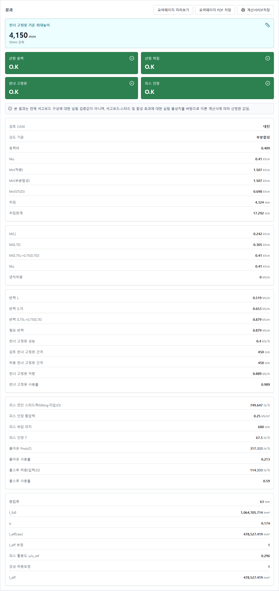

내진에서는 선택한 런너 고정못 간격을 포함한 최대높이를 표시한다. 비내진에서는 응력·처짐·피스 인장을 만족하는 최대높이를 표시한다. 산정값과 각 항목의 사용률을 함께 확인한다.

### 6.3 안내 문구

입력 조건에 따라 표준 외 나사못 간격이나 중립축 관련 안내가 표시될 수 있다. 안내가 표시된 경우 해당 입력 조건과 결과 적용 범위를 확인한다. 안내 문구와 O.K/N.G 판정은 구분하여 확인한다.

## 7. 요약페이지와 구조계산서 출력

1. 계산을 완료한다.
2. 요약페이지 미리보기에서 검토 조건·보드 구성·계산 결과·검토식을 확인한다.
3. 요약페이지 PDF 저장을 누르면 요약 문서를 별도로 저장한다.
4. 상세 구조계산서 미리보기에서 물성과 계산 중간값을 확인한다.
5. 계산서PDF저장을 누르면 상세 계산서를 저장한다.

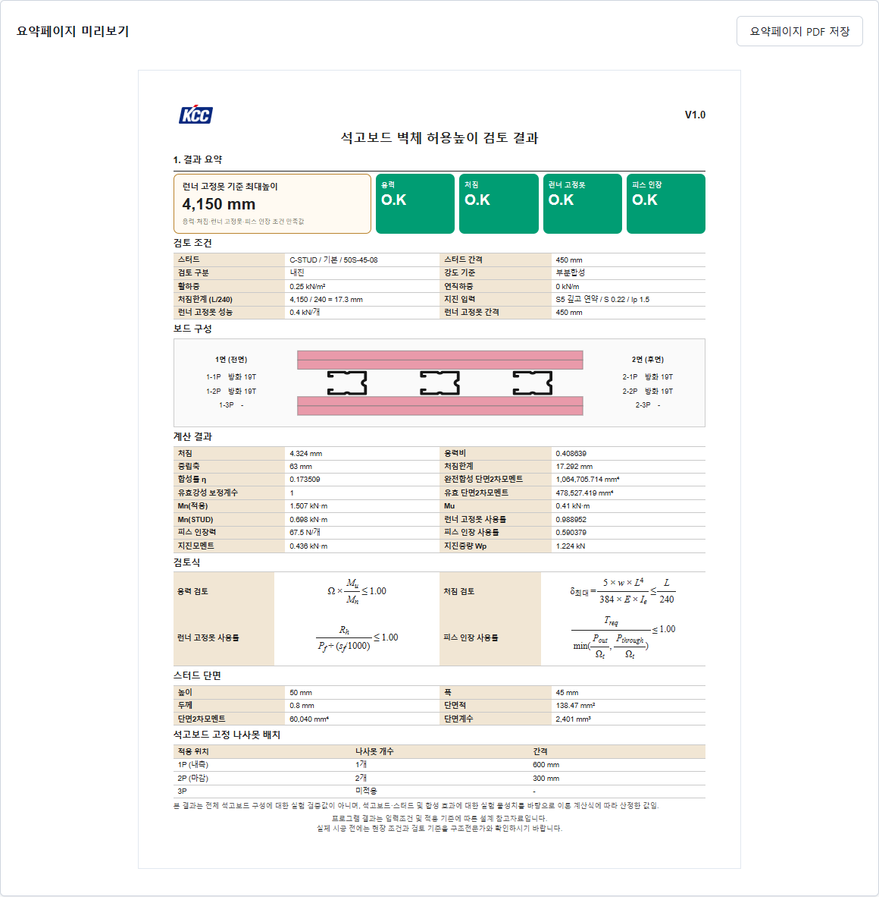

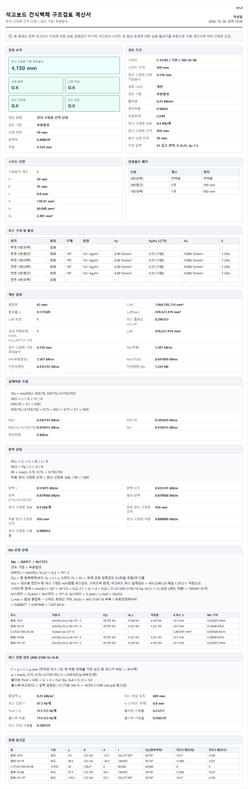

| 문서 | 주요 내용 |
|---|---|
| 요약페이지 | 결과 요약, 입력 조건, 보드 구성, 계산 결과, 검토식, 스터드 단면, 나사못 배치 |
| 상세 구조계산서 | 판정과 조건, 보드 물성, 하중조합, 반력, 휨강도, 피스 인장, 층별 중간값 |

## 8. 문제해결

### 8.1 오류 메시지

| 메시지 요지 | 원인과 조치 |
|---|---|
| 시험 보정계수 R 미산정, 적용 범위 밖 | 등록된 시험 형식으로 변경한다 |
| 이중스터드·일면마감은 후면 보드 입력 불가 | 해당 시공방식의 후면은 없음으로 처리한다 |
| 후면 석고보드 1장 필요, 두께 고정 | 선택한 스터드의 후면 입력 조건을 확인한다 |
| 자재 DB 조회 실패 | 목록에 있는 종류·두께·규격을 선택한다 |
| 나사못 간격 범위 오류 | 사용자 정의를 100~900 mm로 입력한다 |
| 스터드 간격은 150~600 mm 범위여야 함 | 사용자 정의 스터드 간격을 150~600 mm로 입력한다 |
| 설치높이비 z/h는 0.0~1.0 범위여야 함 | z/h를 0.0~1.0으로 입력한다. 모르면 1.0을 입력한다 |
| 자재 목록을 불러오지 못함 | 프로그램을 다시 실행한다. 계속되면 8.2를 확인한다 |
| 백엔드 시작 실패 | 8.2의 증상별 조치를 따른다 |

### 8.2 증상별 조치

KCC Board는 계산용 백엔드(`kcc-board-api.exe`)를 함께 실행한다. 백엔드는 실행할 때마다 Windows가 비어 있다고 알려 준 포트를 사용한다. 그래서 다른 프로그램이 8000 포트를 쓰고 있어도 시작할 수 있다. 프로그램을 종료하면 백엔드도 함께 종료된다. 프로그램이 강제로 종료되어도 백엔드가 1초 안에 스스로 종료된다.

| 증상 | 원인 | 조치 |
|---|---|---|
| "이전 실행의 백엔드 프로세스가 남아 있습니다" 안내 | 이전 실행의 백엔드가 종료되지 않음 | 확인을 누른다. 남은 프로세스를 종료한 뒤 시작한다 |
| "백엔드 시작 실패" 오류 | 백엔드 기동 오류 또는 잔존 프로세스 | 작업 관리자에서 `kcc-board-api.exe`를 종료한 뒤 다시 실행한다. 계속되면 로그 파일을 확인한다 |
| 시작 후 자재 목록이 늦게 표시됨 | 백엔드 기동 지연(백신 검사, 첫 실행) | 최대 15초 기다린다. 계속되면 다시 실행한다 |
| 포트 점유 의심 | 다른 프로그램과의 통신 차단 | 아래 포트 확인 명령으로 사용 중인 프로세스를 확인한다 |
| 자재 DB 조회 실패가 반복됨 | 설치 파일 손상 | 아래 재설치 절차를 따른다 |

로그 파일 위치는 `%APPDATA%\KCC Board\backend-electron.log`이다. 오류 대화상자에도 로그 파일 경로가 표시된다. 로그에는 할당된 포트(`api port: …`)와 백엔드 종료 기록이 남는다.

포트를 확인하려면 다음 순서를 따른다.

1. 로그 파일에서 `api port:` 다음의 숫자를 확인한다.
2. 명령 프롬프트를 연다.
3. `netstat -ano | findstr :{포트}`를 입력한다. `{포트}`는 1에서 확인한 숫자이다.
4. 마지막 열의 PID를 작업 관리자 세부 정보 탭에서 찾는다.

재설치하려면 다음 순서를 따른다.

1. KCC Board를 종료한다.
2. 작업 관리자에서 `kcc-board-api.exe`가 없는지 확인한다. 있으면 작업을 끝낸다.
3. Windows 설정 → 앱에서 KCC Board를 제거한다.
4. 설치 파일을 다시 실행한다.

## 9. 적용 범위와 주의

결과 화면과 계산서(요약·상세)에 다음 안내 문구가 표시된다.

> [주의] 본 결과는 이론 계산값임. 실험으로 검증된 범위는 KCC 11종 시험 시편의 구성(스터드 형식·규격, 보드 종류·두께·겹수, 스터드 간격 300·450·600 mm)과 시험 높이 2.4 m에 한정되며, 산정된 허용높이는 시험 높이를 초과하는 외삽값임. 시험 범위 외 구성(보드 종류·두께·겹수·간격·시공방식의 변경)은 실험으로 직접 검증되지 않았으므로 결과 적용 시 설계자(구조기술자)의 공학적 판단과 확인이 필요함. 합성률 η 및 보정계수 R의 수치 적정성은 기술인증 범위에 포함되지 않음.

> 본 프로그램은 상·하부 런너로 지지되는 전높이 벽체를 대상으로 하며, 부분높이(상단 자유단) 벽체 및 개구부 벽체는 적용 범위 외임.

### 9.1 시험 구성 대조 배지

프로그램은 입력 구성을 KCC 11종 시험 시편 구성과 자동으로 대조한다. 대조 결과는 결과 화면·요약페이지·상세 계산서에 배지로 표시된다. 내진·비내진 모두 표시하며, O.K/N.G 판정에는 영향하지 않는다.

| 배지 | 의미 |
|---|---|
| 입력 구성은 시험 시편 No.{n}(높이 2.4 m)와 일치함 | 스터드 형식·규격·시공방식, 전·후면 보드 종류·두께·겹수, 스터드 간격이 시편 No.{n}과 같다 |
| 입력 구성은 시험 시편과 일치하지 않음 — 이론 산정값 (차이: …) | 가장 가까운 시편과 다른 항목을 괄호 안에 표시한다 |

차이 항목은 스터드 형식, 스터드 규격, 시공방식, 보드 종류, 보드 두께, 보드 겹수, 스터드 간격 중에서 표시된다. 시공방식은 C-STUD에만 비교한다. 시험 구성 정의는 `data/seed/stud_method.json`의 `tested_configurations`이다.

형식별 보정계수 R은 시험 시편의 허용처짐 상태를 기준으로 산정한 계수이다. 시험 조건과 다른 높이·간격 구성 및 표준 외 나사못 간격은 결과 적용에 유의한다. 계산식의 상세는 소스의 docs/var_formula_spec.md를 참고한다.

이중스터드는 일면 시험 형식 계수를 적용한다. 실제 설계조건과 시공 상세의 적합성을 확인하여 결과를 사용한다.
