# KCC Board 사용 매뉴얼 (v0.7.4)

KCC Board는 석고보드·스터드 부분합성 건식벽체의 면외 구조검토 프로그램이다. 벽체 구성과 하중을 입력하면 응력·처짐·피스 인장을 검토하고, 내진에서는 런너 고정못 사용률을 함께 검토한다. 결과는 요약페이지 또는 상세 계산서로 출력할 수 있다.

> 본 결과는 전체 석고보드 구성에 대한 실험 검증값이 아니며, 석고보드·스터드 및 합성 효과에 대한 실험 물성치를 바탕으로 이론 계산식에 따라 산정한 값임.

메뉴 Help → 사용 매뉴얼 또는 F1으로 이 매뉴얼을 연다. 별도 창으로 열리며 계산 화면의 입력값은 유지된다. 화면은 v0.7.3 기준이다.

## 1. 설치와 실행

1. GitHub Release에서 `KCC.Board.Setup.0.7.4.exe`를 내려받는다.
2. 설치 파일을 실행한다. 현재 사용자 계정에 설치된다.
3. Windows SmartScreen 경고가 나오면 "추가 정보 → 실행"을 누른다. 코드서명 인증서가 없어서 나오는 경고이다.
4. 시작 메뉴에서 KCC Board를 실행한다.
5. 화면 상단의 API 연결 상태를 확인한다. 자재 목록을 불러오지 못하면 프로그램을 다시 실행한다.

## 2. 화면 구성

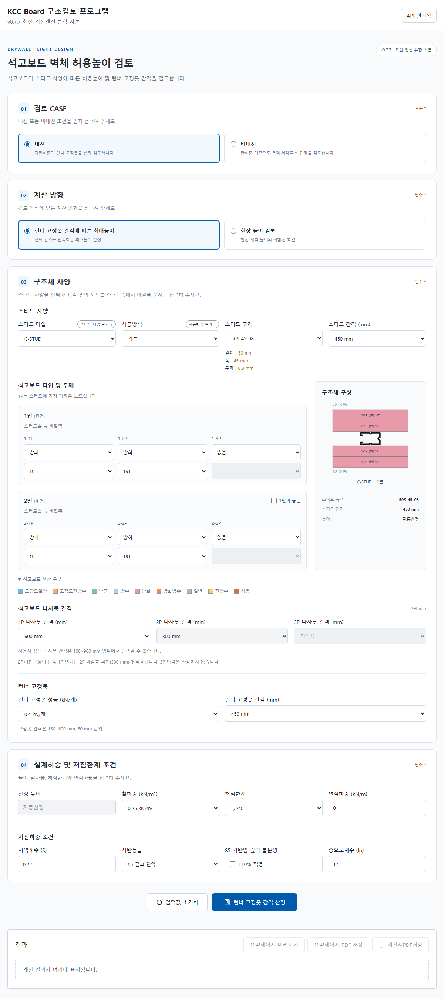

| 영역 | 내용 |
|---|---|
| 검토 CASE | 내진 또는 비내진 선택 |
| 계산 방향 | 최대높이 산정 또는 현장 높이 검토 |
| 구조체 사양 | 스터드·시공방식·규격, 양면 보드, 나사못 및 런너 고정못 입력 |
| 구조체 구성 | 입력한 보드와 스터드의 구성 그림 |
| 설계하중 및 처짐한계 조건 | 현장 높이, 활하중, 처짐한계, 연직하중 및 지진 조건 |
| 계산 결과 | 판정, 주요 수치와 입력 조건 |
| 요약·상세 미리보기 | 요약페이지 및 구조계산서 확인·PDF 저장 |

## 3. 기본 사용 절차

1. 내진 또는 비내진 CASE를 선택한다.
2. 최대높이 산정 또는 현장 높이 검토를 선택한다.
3. 스터드·시공방식·규격과 각 면의 보드를 선택한다.
4. 나사못 간격과 내진의 런너 고정못 조건을 입력한다.
5. 설계하중과 처짐한계, 내진의 지진 조건을 입력한다.
6. 구조체 구성 그림을 확인하고 하단 계산 버튼을 누른다.
7. 판정과 요약·상세 미리보기를 확인한 뒤 필요한 PDF를 저장한다.

입력을 초기 상태로 되돌리려면 입력값 초기화를 누른다.

## 4. 계산 방향

| 계산 방향 | 높이 입력 | 결과 |
|---|---|---|
| 비내진 최대높이 산정 | 자동산정, 직접 입력 불가 | 응력·처짐·피스 인장을 만족하는 최대높이 |
| 내진 런너 고정못 간격에 따른 최대높이 | 자동산정, 직접 입력 불가 | 응력·처짐·런너 고정못·피스 인장을 만족하는 최대높이 |
| 현장 높이 검토 | 계획한 현장 높이를 입력 | 입력 높이에서 각 항목의 적합성 판정 |

최대높이는 50 mm 단위로 산정한다. 산정 후 표시되는 상세 수치와 판정은 산정된 높이 기준이다. CASE나 계산 방향을 바꾸면 이전 결과를 지우고 다시 계산한다.

## 5. 입력 항목

### 5.1 석고보드

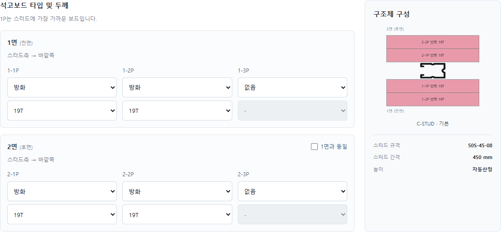

1면은 전면, 2면은 후면이다. 각 면 최대 3장까지 종류와 두께를 선택한다. 1P는 스터드에 가장 가까운 보드이며 2P·3P 순서로 바깥쪽에 놓인다. 사용하지 않는 칸은 없음으로 둔다.

2면의 1면과 동일을 선택하면 1면의 종류와 두께를 2면에 동일하게 적용한다. 고정 구성에서는 이 기능을 사용할 수 없다. 보드 색상 구분은 입력 화면 아래 범례에서 확인한다.

| 조건 | 2면 후면 보드 |
|---|---|
| C-STUD 일면마감 또는 이중스터드 | 한쪽 면만 검토하므로 모든 칸 없음, 입력 비활성화 |
| CH-STUD | 후면 1장, 두께 25T 고정 |
| CH-STUD 12.5T형 | 후면 1장, 두께 12.5T 고정 |
| I-STUD | 후면 1장, 등록된 보드 종류·두께 선택 가능 |

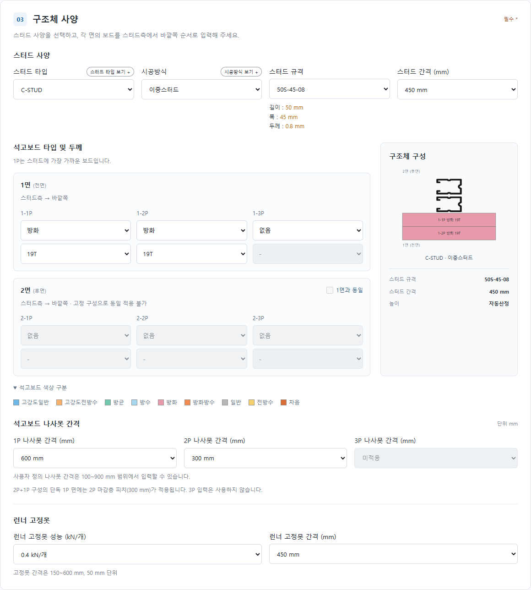

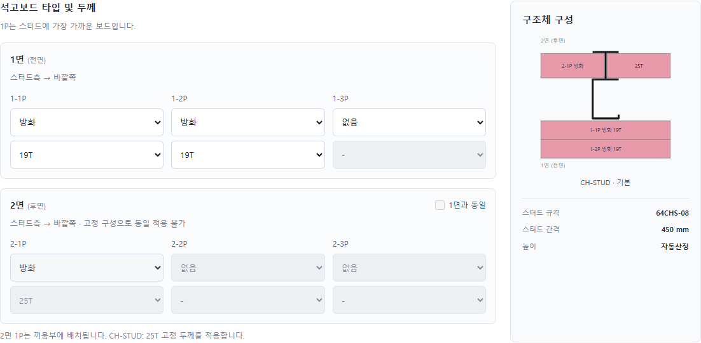

### 5.2 스터드

| 항목 | 내용 |
|---|---|
| 스터드 타입 | C·CH·CH 12.5T형·I·HR·MP·T.silent·R·RV |
| 시공방식 | 선택한 스터드에 적용 가능한 방식 |
| 스터드 규격 | 형식별 등록 규격과 길이·폭·두께 정보 |
| 스터드 간격 | 300·450·600 mm 또는 사용자 정의 |

스터드 타입 보기와 시공방식 보기를 누르면 해당 설명 이미지를 팝업으로 볼 수 있다. 스터드 타입을 변경한 뒤 시공방식과 규격을 확인한다. 시험 보정계수가 없는 형식은 적용 범위 밖으로 계산하지 않는다.

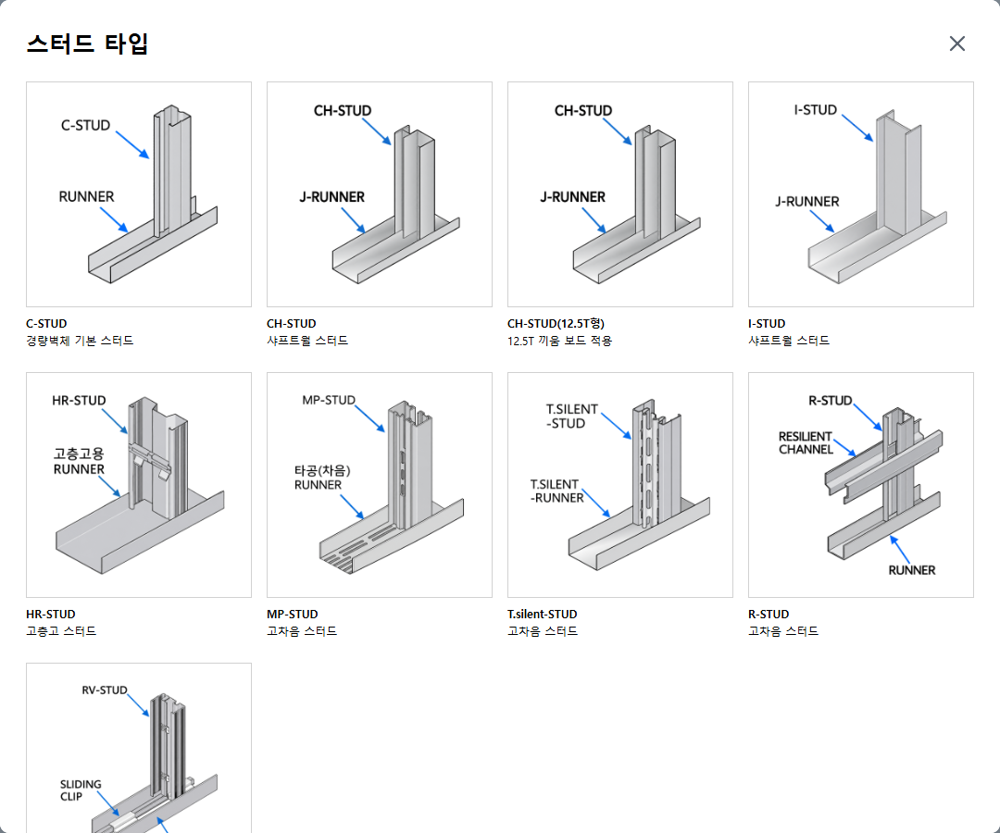

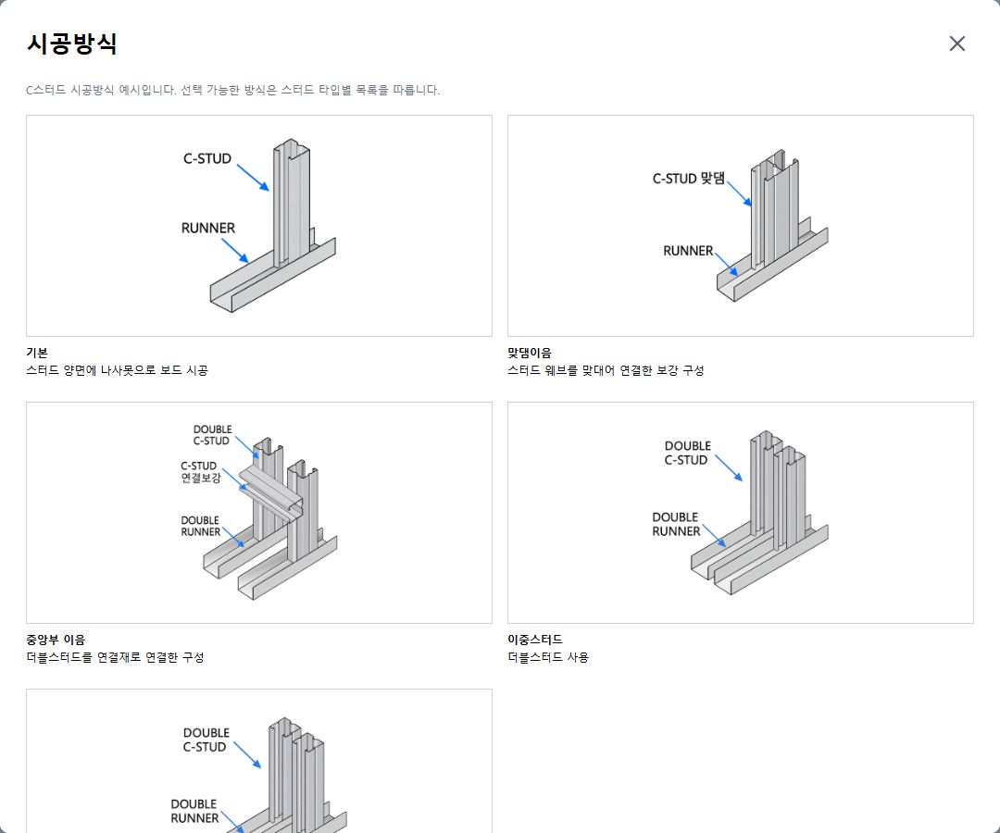

### 5.3 나사못과 런너 고정못

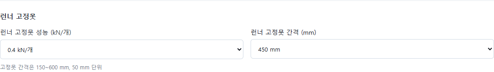

| 항목 | 선택 범위 |
|---|---|
| 각 겹 나사못 간격 | 300·450·600 mm 또는 사용자 정의 100~900 mm |
| 런너 고정못 성능 | 0.4·0.2 kN/개 또는 사용자 정의 |
| 런너 고정못 간격 | 150~600 mm, 50 mm 단위 |

실제 사용하는 겹수의 나사못 간격을 확인한다. 런너 고정못 항목은 내진 CASE에서만 표시된다.

### 5.4 하중과 처짐한계

| 항목 | 입력 방법 |
|---|---|
| 현장 높이 | 현장 높이 검토에서 mm 단위 입력 |
| 활하중 | 0.25·0.36·0.48 kN/m² 또는 사용자 정의 |
| 처짐한계 | L/240·L/300·L/360 또는 사용자 정의 |
| 연직하중 | kN/m 단위 입력, 기본값 0 |

처짐한계는 높이를 선택한 분모로 나눈 값이다. 예를 들어 높이 3,840 mm, L/240이면 허용처짐은 16 mm이다.

### 5.5 지진

| 항목 | 기본값 | 설명 |
|---|---|---|
| 지역계수 S | 0.22 | 유효지반가속도 입력 |
| 지반등급 | S5 | S1~S5, Fa 자동 산정 |
| S5 기반암 깊이 불분명 | 해제 | S5에서 선택 시 Fa 110% 적용 |
| 중요도계수 Ip | 1.5 | 중요도계수 입력 |

비내진 CASE에서는 지진 관련 입력과 결과가 표시되지 않는다.

## 6. 결과 보기

### 6.1 현장 높이 검토

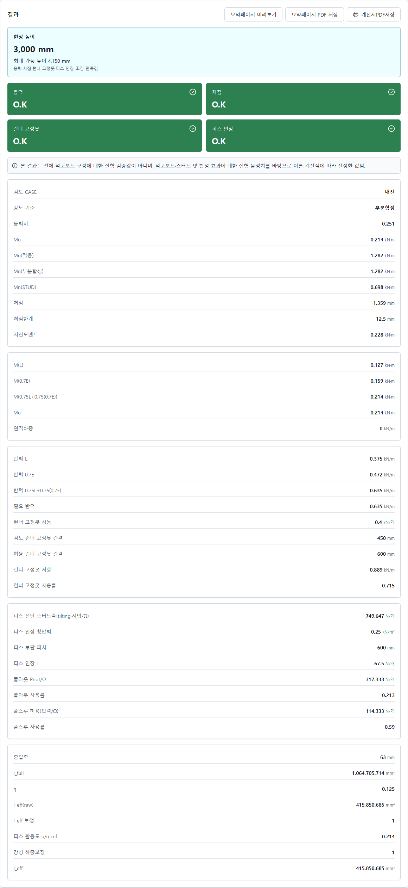

| 판정 | 기준 |
|---|---|
| 응력 | Ω·Mu/Mn ≤ 1.0 |
| 처짐 | 활하중 처짐 ≤ 높이/처짐한계 분모 |
| 런너 고정못 | 사용률 ≤ 1.0, 내진에서만 검토 |
| 피스 인장 | 풀아웃·풀스루 사용률 ≤ 1.0 |

내진은 4개, 비내진은 3개 판정을 표시한다. 초록색 O.K는 만족, 빨간색 N.G는 불만족이다. 결과와 계산서의 검토 높이가 의도한 높이와 같은지 확인한다.

### 6.2 최대높이

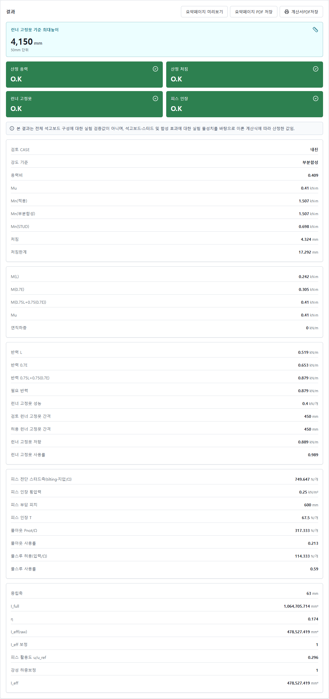

내진에서는 선택한 런너 고정못 간격을 포함한 최대높이를 표시한다. 비내진에서는 응력·처짐·피스 인장을 만족하는 최대높이를 표시한다. 산정값과 각 항목의 사용률을 함께 확인한다.

### 6.3 안내 문구

입력 조건에 따라 표준 외 나사못 간격이나 중립축 관련 안내가 표시될 수 있다. 안내가 표시된 경우 해당 입력 조건과 결과 적용 범위를 확인한다. 안내 문구와 O.K/N.G 판정은 구분하여 확인한다.

## 7. 요약페이지와 구조계산서 출력

1. 계산을 완료한다.
2. 요약페이지 미리보기에서 검토 조건·보드 구성·계산 결과·검토식을 확인한다.
3. 요약페이지 PDF 저장을 누르면 요약 문서를 별도로 저장한다.
4. 상세 구조계산서 미리보기에서 물성과 계산 중간값을 확인한다.
5. 계산서PDF저장을 누르면 상세 계산서를 저장한다.

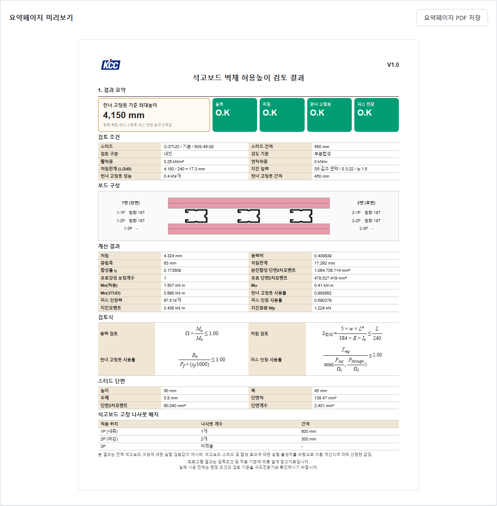

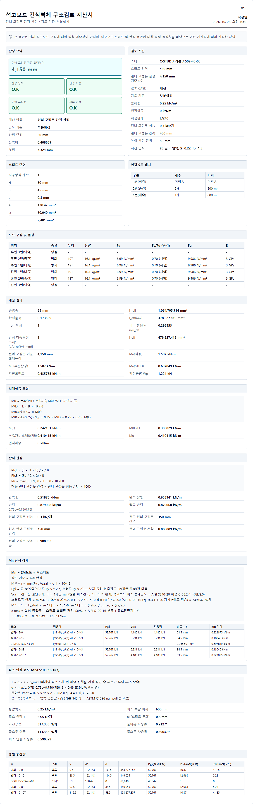

| 문서 | 주요 내용 |
|---|---|
| 요약페이지 | 결과 요약, 입력 조건, 보드 구성, 계산 결과, 검토식, 스터드 단면, 나사못 배치 |
| 상세 구조계산서 | 판정과 조건, 보드 물성, 하중조합, 반력, 휨강도, 피스 인장, 층별 중간값 |

## 8. 오류 메시지

| 메시지 요지 | 원인과 조치 |
|---|---|
| 시험 보정계수 R 미산정, 적용 범위 밖 | 등록된 시험 형식으로 변경한다 |
| 이중스터드·일면마감은 후면 보드 입력 불가 | 해당 시공방식의 후면은 없음으로 처리한다 |
| 후면 석고보드 1장 필요, 두께 고정 | 선택한 스터드의 후면 입력 조건을 확인한다 |
| 자재 DB 조회 실패 | 목록에 있는 종류·두께·규격을 선택한다 |
| 나사못 간격 범위 오류 | 사용자 정의를 100~900 mm로 입력한다 |
| 자재 목록을 불러오지 못함 | 프로그램을 다시 실행한다 |
| API 포트 사용 중 | KCC Board가 이미 실행 중인지 확인한다 |

## 9. 적용 범위와 주의

형식별 보정계수 R은 시험 시편의 허용처짐 상태를 기준으로 산정한 계수이다. 시험 조건과 다른 높이·간격 구성 및 표준 외 나사못 간격은 결과 적용에 유의한다. 계산식의 상세는 소스의 docs/var_formula_spec.md를 참고한다.

이중스터드는 일면 시험 형식 계수를 적용한다. 실제 설계조건과 시공 상세의 적합성을 확인하여 결과를 사용한다.
